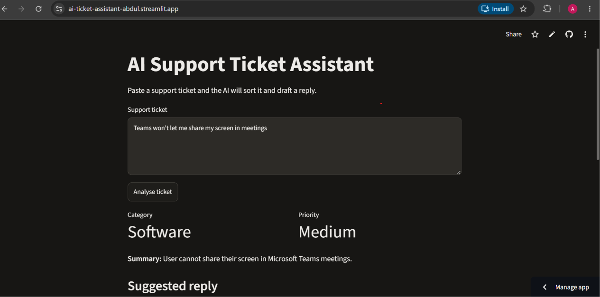
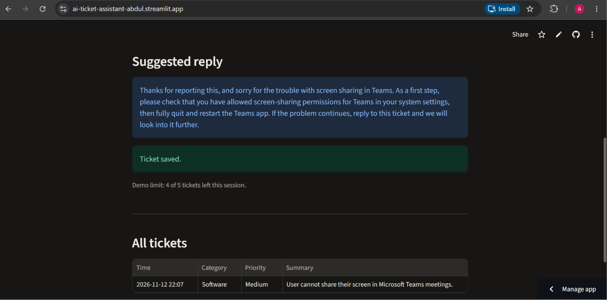

# AI Support Ticket Assistant

An AI-powered web app that reads IT support tickets, sorts them by category and priority, writes a short summary, and drafts a friendly reply.

**Live demo:** https://ai-ticket-assistant-abdul.streamlit.app





## What it does

Paste in a support ticket like *"The whole office has no internet"*, and the app returns:

- **Category:** Network, Hardware, Software, Account or Other
- **Priority:** Low, Medium or High
- **Summary:** one clear sentence
- **Suggested reply:** a short, friendly response with a sensible first step

Every ticket is saved to a database, and each visitor sees a history table of their own tickets from that session.

## How it works

1. The Streamlit front end (`app.py`) takes the ticket.
2. `triage.py` sends it to the Claude API with a structured prompt that asks for JSON only, with fixed categories and clear priority rules.
3. The response is parsed with a safety net: unknown categories or priorities fall back to safe defaults, and missing fields are filled in.
4. The result is saved to a SQLite database (`database.py`) and shown on the page. The history table on the page only shows the current visitor's own tickets.

## Testing and accuracy

**Unit tests (pytest):** `test_triage.py` checks the response parser against fake AI responses, including extra text around the JSON, invalid categories and priorities, missing fields, and responses with no JSON. These tests run without calling the API.

**Accuracy evaluation:** `evaluate.py` runs 30 labelled example tickets (`eval_data.py`) through the AI and compares its answers with the expected ones.

| Change | Category accuracy | Priority accuracy |
|---|---|---|
| First run | 93% | 77% |
| Fixed a bug where the model's "thinking" block was read instead of its text answer | 100% | 83% |
| Added explicit priority rules to the prompt | 100% | 100% |

This is a small test set written with the same priority rules given to the model, so real-world accuracy on messier tickets would likely be lower. Testing on a larger, more varied set is the next step.

## Tech stack

Python, Streamlit, Claude API (Anthropic), SQLite, pandas, pytest, Git

## Run it locally

```
git clone https://github.com/40692317/ai-ticket-assistant.git
cd ai-ticket-assistant
python -m venv venv
venv\Scripts\activate
pip install -r requirements.txt
```

Create a `.env` file with your own API key:

```
ANTHROPIC_API_KEY=your-key-here
```

Then run:

```
streamlit run app.py
```

Run the tests with `pytest`, and the accuracy evaluation with `python evaluate.py`.

## Safety

- The API key is kept out of the code: in a `.env` file locally (ignored by Git) and in Streamlit secrets online.
- The live demo limits each visitor to 5 tickets per session and 1,000 characters per ticket.
- Each visitor only sees their own tickets. An earlier version showed every visitor's tickets in one shared table, which I changed for privacy.

## What I'd add next

- A larger and messier evaluation set
- Filters on the ticket history by category and priority
- User login so each support agent sees their own tickets
